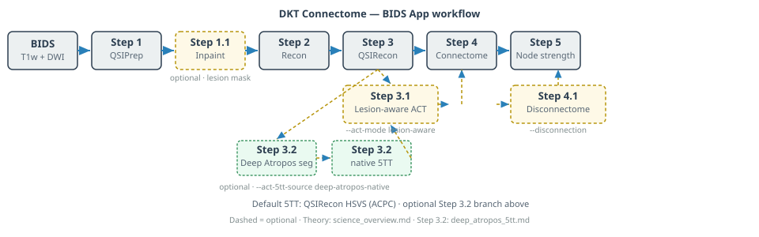

# DKT Connectome — lesion-aware structural connectomics BIDS App

DKT Connectome turns BIDS DWI + T1w into a **78-node DKT structural connectome**. With a lesion mask and `--disconnection`, the same run can inpaint T1w and estimate which edges the lesion interrupts. It is **study-agnostic**: lesion steps stay off unless a mask and flags are present. One paragraph per step: **[What DKT Connectome does](what_it_does.md)**.

Public software checks: [IDEAS II](datasets/ideas.md) and [BTC glioma](datasets/btc_glioma.md) — [Sample results](sample_results.md). TRACK-TBI DoD Phase 1 was run under a DUA (data not in this repo) and is not a public validation claim.

**Linux + Apptainer** (FreeSurfer license required). Docker is an orchestrator only: [One-pull](installation.md#one-pull-docker--cloud). **Release:** [v0.3.1](https://github.com/phindagijimana/dkt_connectome/releases/tag/v0.3.1).



**Next:** [Tutorial](tutorial.md) · [Sample results](sample_results.md) · [Methods](methods/index.md) · [References](references.md)

| Also | Page |
|------|------|
| Install / license / Docker | [Installation](installation.md) |
| Flags | [Usage](usage.md) |
| Why the steps exist | [Science overview](science_overview.md) |
| Your BIDS | [Preparing your data](preparing_data.md) |
| Problems | [FAQ](faq.md) · [Troubleshooting](troubleshooting.md) |

Advanced (not in the sidebar): [decision tables](decision_tables.md) · [factorial arms](TBI_Experimental_Arms.md) · [pipeline steps](pipeline_steps.md) · [Deep Atropos](deep_atropos_5tt.md) · [lesion-aware ACT](lesion_aware.md) · [disconnectome CLI](disconnectome.md) · [cloud](cloud_deployment.md).

This pipeline **orchestrates** [QSIPrep](https://qsiprep.readthedocs.io/), [QSIRecon](https://qsirecon.readthedocs.io/), FreeSurfer/FastSurfer, MRtrix3, and neuroLIT. Cite those papers — [References by step](references.md).

---

## Quick start

Work from `dwi_pipeline/` after clone. Full walkthrough: [Tutorial](tutorial.md).

```bash
git clone https://github.com/phindagijimana/dkt_connectome.git
cd dkt_connectome/dwi_pipeline
chmod +x dkt run install
export FS_LICENSE=/path/to/your/license.txt
export DKT_CONTAINER_CACHE=$HOME/.cache/dkt-connectome/containers
export APPTAINER_TMPDIR=$HOME/.cache/dkt-connectome/apptainer_tmp
export PROOT_TMP_DIR=$APPTAINER_TMPDIR
mkdir -p "$DKT_CONTAINER_CACHE" "$APPTAINER_TMPDIR"
./dkt install && ./dkt check --strict
```

Then [Tutorial](tutorial.md) (IDEAS download + dry-run). Own BIDS: `./dkt run /path/to/BIDS /path/to/out participant --participant-label 01 --session-filter ses-1 --n-cpus 8 --fastsurfer --syn`. HPC: `bash dwi_pipeline/submit.sh` from the repo root.

---

## Contact

<a id="contact"></a>

- **GitHub:** [github.com/phindagijimana/dkt_connectome](https://github.com/phindagijimana/dkt_connectome) · [open an issue](https://github.com/phindagijimana/dkt_connectome/issues)
- **Email:** [phindagiji@gmail.com](mailto:phindagiji@gmail.com)
- [FAQ](faq.md) · [Troubleshooting](troubleshooting.md) · [NeuroStars](https://neurostars.org/)
