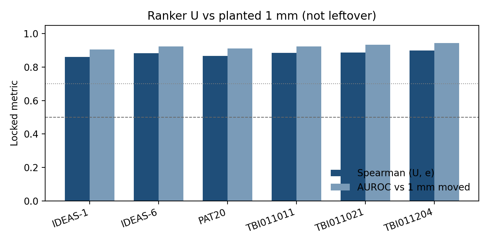
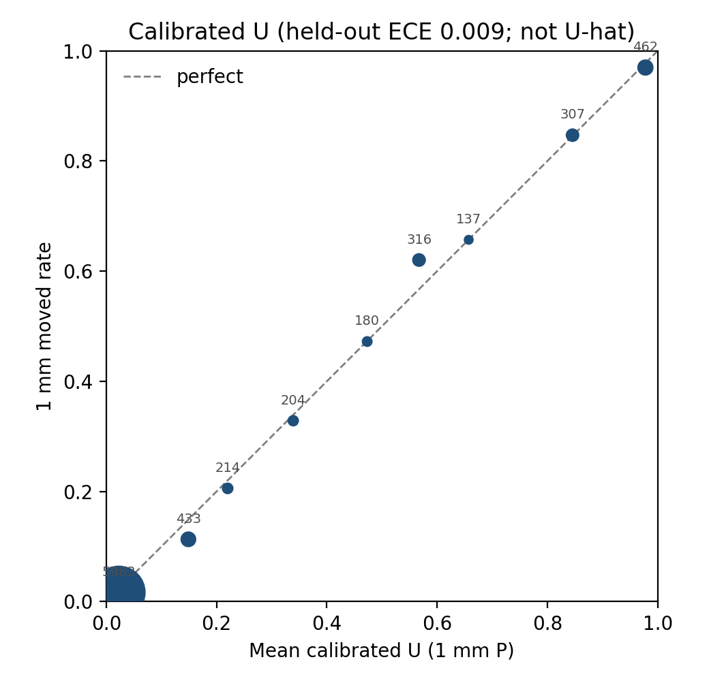
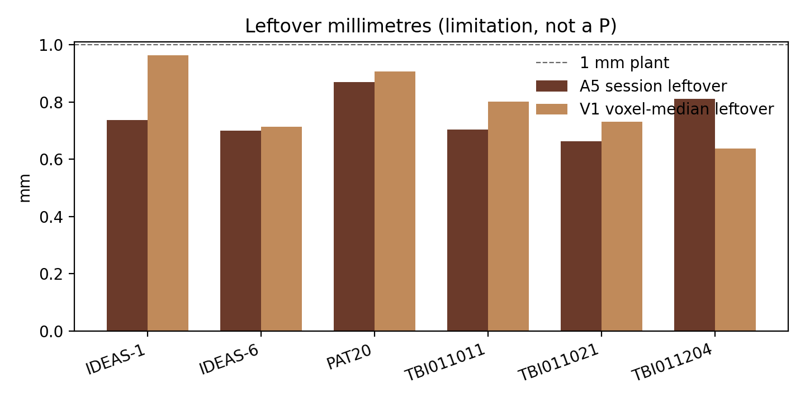

> **Paper 1 status (20 Oct 2026).** Claim stays: \(U\) is a QC footnote, calibrated \(U\) is a 1 mm phantom probability, A5/V1 leftover mm is the limitation, A8/L2 is the failed leftover-\(P\) attempt.
>
> | Still needed for submission | State |
> |---|---|
> | Cheap baselines on the same edges (low count, boundary distance, unlabeled-end fraction, short edge, C2 leakage) | Locked `work/P1/LOCK.json`; Slurm **189590** (after C2). Fills §3.7. |
> | Cut sensitivity (relchange 0.15/0.25/0.35 × count floor 5/10/20) | Same job. Fills §3.8. 0.25/10 stays primary. |
> | U algebra reproducibility | Done: recomputed \(U\) from stored maps matches shipped \(U\) to \(5\times10^{-9}\) (generator source was lost; rule recovered from bytecode). |
> | SIFT2 event | Not possible from stored maps (count only). Needs weighted re-assignment. Limitation unless rerun. |
> | Second atlas | Not started. Limitation. |
> | Downstream consequence (edges a group test would drop) | Not started. Writing task. |
>
> Papers 2 and 3 are separate documents: `PAPER2_LEFTOVER_UQ.md`, `PAPER3_C2_SOFT_ASSIGN.md`.

# Residual T1–DWI mapping error still moves DKT edges after ordinary QC

**Not \(\hat U\).** Not a leftover-connectome probability. Not a first disconnectome. Local TrackTBI-Sub. Do not push to public `dkt_connectome`.

**Product.** (i) A frozen small-shift ranker \(U\) for which count≥10 DKT edges jump under a held-out ±1 mm plant. (ii) An isotonic map of \(U\), fit on development sessions only, that is a **probability for that same planted 1 mm event**.

**Not the product.** \(P(\text{edge wrong}\mid\text{measured leftover})\). An ANTs leftover ensemble was tested and did not become that number (A8, L2).

Venue: methods (*Human Brain Mapping* / *NeuroImage* methods). Sensitivity that millimetres move edges is occupied (Qi 2018; Buchanan 2015; Greene 2019; Yeh 2021). The contribution is the **ranking rule + a checked 1 mm probability**, after ordinary QC has already said PASS.

---

## Abstract

After structural connectome QC reports PASS and empty DKT nodes = 0, leftover millimetre-scale T1–DWI parcel error can still change streamline assignment. We freeze iFOD2 endpoints, SIFT2, 78-node DKT, and `radial_4`, then re-assign under 12 small translations (\(\pm0.25\), \(\pm0.5\) mm on three axes). Edge-wise \(U\) is the worst relative count change on those maps (count floor 10). The test event is the same algebra on held-out \(\{\pm1\}\) mm. Moved means relative change \(>0.25\).

On three public development sessions, Spearman\((U,e)\) was 0.86–0.88 and AUROC 0.91–0.92. On three held-out TRACK-TBI 2WK lesion-ACT sessions (not in the development split), Spearman was 0.89–0.90 and AUROC 0.92–0.94. Ordinary QC flagged 0 edges; \(U>0.25\) flagged 78–138 count≥10 edges per session at precision 0.97–0.99 vs 1 mm movers (recall 0.20–0.29).

Raw \(U\) is a ranker, not a percent. An isotonic map fit on the three development sessions and frozen before test ECE is a probability for the 1 mm event: held-out ECE 0.009 vs 0.121 for uncalibrated \(U\); in \([0.9,1.0]\) mean \(P=0.978\) vs moved 0.970 (\(n=462\)).

This is not leftover uncertainty quantification. A registration ensemble on already-aligned T1 vs dwiref produced leftover millimetres (~0.7 mm) but not a calibrated edge probability for planted 1 mm or for leftover-sized endpoint shift. Gold \(\hat U\) needs an independent leftover source locked before new numbers.

---

## 1. Introduction

QSIPrep and ANTs put T1w anatomy and the DWI assignment grid into a common space (Cieslak 2021; Avants 2011). Subject-level DKT QC can still report PASS with no empty nodes while a millimetre of residual parcel error remains. Yeh (2021) and the MRtrix assignment docs already say leftover millimetres move who an endpoint is assigned to. Planted-shift sensitivity of connectomes is occupied (Qi 2018; Buchanan 2015; Greene 2019). What is missing is a **fixed, session-held-out ranking rule** for *which* count≥10 edges move, after the pipeline has already accepted the session — and, separately, a number that can be read as a **probability** for that planted event.

We do not claim a new millimetre-sensitivity fact. We claim a reusable edge map \(U\) and a checked calibration of \(U\) to the locked 1 mm test.

---

## 2. Methods (frozen)

### 2.1 Freeze

iFOD2 endpoints, SIFT2 weights unused for the count event, DWI-space 78-node DKT, assignment `radial_4` (4 mm). Do not rerun QSIPrep, recon, or tractography. Do not change the radius (Yeh 2019: assignment is consequential).

### 2.2 Ranker \(U\)

For each undirected edge \(ij\) with \(\max(C)\ge 10\) over identity and the planted maps, else \(U_{ij}=0\):

\[
U_{ij}=\max_{s\in\mathrm{fit}}\frac{|C^s_{ij}-C^0_{ij}|}{\max(C^s_{ij},C^0_{ij},\varepsilon)},\qquad \varepsilon=10^{-9}.
\]

Fit plants: \(\{\pm0.25,\pm0.5\}\) mm on \(x,y,z\) (12 maps). Test plants: \(\{\pm1\}\) mm on \(x,y,z\) (6 maps). Target \(e_{ij}\) is the same relative change on the test maps. Moved: \(e_{ij}>0.25\) and \(\max(C^0,C^{\mathrm{1mm}})\ge 10\). Eligibility for confirmation tables: \(\max(C)\ge 10\) over identity and all 18 planted maps.

Primary metrics, written on development and not retuned: Spearman\((U,e)\); AUROC of \(U\) vs moved. Win: both Spearman \(>0.5\) and AUROC \(>0.7\) on ≥2 of 3 sessions. \(Q\) is mean \(U\) on eligible edges (descriptive).

### 2.3 Review rule (frozen \(U>0.25\))

Ordinary QC has no per-edge flag. Compare session accept (QC PASS, empty nodes = 0) to an edge footnote \(U_{ij}>0.25\). Precision vs 1 mm movers; recall is expected low (conservative).

### 2.4 Calibrated \(U\) (experiment C; locked 19 October 2026)

Isotonic regression (Zadrozny & Elkan 2002; increasing; clip out of range) maps \(U\) to \(P_{\mathrm{cal}}(U)\). Fit on the three development sessions only (\(n=8112\) eligible edges; 1 mm moved rate 0.153). High bin = highest equal-width tenth of \(P_{\mathrm{cal}}\) with \(n\ge 20\) on the **fit** set (B10). Then test on pooled confirmation edges (\(n=8236\)). Win: ECE(\(P_{\mathrm{cal}}\)) strictly below ECE(raw \(U\)), and the frozen high bin evaluable (\(n\ge 20\)) with \(|\overline y-\overline P|\le 0.15\).

This does not retune \(U\). It does not use leftover warps. It is not \(\hat U\).

### 2.5 Why a planted 1 mm test (not fabricated leftover)

We fabricate the **shift**, not the connectome. Endpoints, DKT, and `radial_4` stay the real freeze. A known \(\pm 1\) mm translation is a digital phantom: the label is known because we imposed it. Planted-shift / perturbation sensitivity of connectomes is the occupied fact (Qi 2018; Buchanan 2014/2015; Greene 2018/2019; Yeh 2019, 2021). The new claim is a frozen ranking plus a checked probability for **that same plant**.

1 mm is not this patient’s leftover. A5 leftover after usual T1–dwiref alignment is 0.66–0.81 mm on the three confirmation sessions (session median \(M_s\); SyN subset 0.63–0.84 mm; pooled p95 1.36–1.46 mm). A leftover-sized endpoint translation (L2, \(t\approx 0.6\)–\(0.9\) mm) moved 1.9% of eligible edges; the 1 mm plant moved 16%. So 1 mm sits in the same millimetre band as leftover (especially the A5 upper tail) but is a **stronger edge event**. Calibrated \(U\) is therefore a sound 1 mm probability and is not \(\hat U\).

### 2.6 Splits

Development (`mapping_screen_dev_v1`): IDEAS sub-1, IDEAS sub-6, BTC PAT20. Confirmation (`mapping_screen_confirm_v1`): TRACK-TBI TBI011011 / 011021 / 011204, 2WK neurolit-lesion ACT, Slurm 188365. Sessions held out, not edges.

---

## 3. Results

### 3.1 Development (3/3 win)

| Session | \(n\) | 1 mm moved | Spearman | AUROC | \(Q\) |
|---|---:|---:|---:|---:|---:|
| ideas-sub-1 | 2742 | 389 | 0.861 | 0.906 | 0.075 |
| ideas-sub-6 | 2703 | 464 | 0.883 | 0.923 | 0.080 |
| PAT20 | 2667 | 389 | 0.867 | 0.912 | 0.078 |

Identity assignment agreed with the freeze (pair agree ≥0.999; count Spearman 1.0).

### 3.2 Confirmation (3/3 win)

| Session | \(n\) | 1 mm moved | Spearman | AUROC | \(Q\) |
|---|---:|---:|---:|---:|---:|
| TBI011011 | 2604 | 439 | 0.886 | 0.923 | 0.083 |
| TBI011021 | 2791 | 426 | 0.887 | 0.935 | 0.077 |
| TBI011204 | 2841 | 474 | 0.899 | 0.945 | 0.083 |

`pursue_u_as_experiment_1_product = true`.

### 3.3 Review decision (holds)

QC flagged **0** edges on all six sessions. \(U>0.25\) flagged 78 / 111 / 98 (dev) and 118 / 104 / 138 (confirm) edges. Precision vs 1 mm movers 0.980–0.993; recall 0.198–0.289. QC would accept every session; \(U\) would footnote those edges.

### 3.4 Calibrated \(U\) (C win)

Held-out pooled confirmation, locked mask:

| | |
|---|---|
| \(n\) | 8236 |
| 1 mm moved rate | 0.163 |
| ECE raw \(U\) | 0.121 |
| ECE isotonic \(U\) | **0.009** |
| Fit-frozen high bin | B10 \([0.9,1.0]\) |
| TBI B10 | \(n=462\), \(\overline P=0.978\), \(\overline y=0.970\) |

When calibrated \(U\) is about 0.98, about 97% of those edges are 1 mm movers. Raw \(U=0.3\) is still not “30%.”

### 3.5 Leftover millimetres are real; leftover \(P\) is not (A5 / A8 / L2)

An ANTs leftover ensemble on already-aligned T1 vs dwiref (A5) measured leftover millimetres. Confirmation session \(M_s\): 0.70 / 0.66 / 0.81 mm (TBI011011 / 011021 / 011204). That leftover is a **limitation** of the 1 mm probability, not a second product. The empirical frequency of \(e>0.25\) under that ensemble (`proxyUhat`) was **not** a better probability than min–max \(U\) for the 1 mm event (A8; B9 empty). A leftover-sized endpoint translation (L2) moved 1.9% of eligible edges; edges with `proxyUhat` in \([0.5,0.6)\) moved 14%, not 52%. Those exams stay negative. The filename stays `proxyUhat`. We do not name proxy-\(\hat U\).

### 3.6 Voxel leftover on \(\phi\) (V1 win; not \(\hat U\))

The same A5 SyN members (\(K=25\) per session), summarised at labeled voxels: voxel-wise median and SD of leftover millimetres. Confirmation:

| Session | Voxel-median leftover (mm) | Voxel-SD leftover (mm) | p95 of voxel medians |
|---|---:|---:|---:|
| TBI011011 | 0.80 | 0.20 | 1.53 |
| TBI011021 | 0.73 | 0.21 | 1.50 |
| TBI011204 | 0.64 | 0.18 | 1.22 |

This is Hub / Kybic registration uncertainty on \(\phi\). It is not Simpson, not VoxelMorph, not a 78×78 \(P\). Evidence: `methods/mapping_uhat/work/V/`.

### 3.7 Cheap baselines (pending, P1)

Same six sessions, same eligible mask, same 1 mm event. Scores (higher = predicted mover): \(-C^0\); minus mean endpoint distance to a DKT label boundary; fraction of endpoints that needed the radial search; minus mean endpoint–endpoint distance; C2 leakage \(F\) (planted \(y\) only). Spearman and AUROC beside \(U\). Descriptive; nothing retunes \(U\). Output: `methods/mapping_uhat/work/P1/p1_summary.json`.

### 3.8 Cut sensitivity (pending, P1)

\(U\), \(e\), mask and moved recomputed from the stored 18 planted maps at relchange \(\{0.15, 0.25, 0.35\}\) × count floor \(\{5, 10, 20\}\). 0.25 / 10 is the locked primary; the grid is a robustness table, not a re-choice.

---

## 4. Discussion

Ordinary QC is a session gate. \(U\) is an edge footnote for planted millimetre residual. Calibrated \(U\) is the same footnote stated as a probability for the locked 1 mm test. That is enough for a methods paper if the claim stays inside that sentence.

Leftover **uncertainty quantification** is still a real gap. Image-registration UQ exists at voxels (Simpson 2012; Hub 2009; Kybic 2010; Dalca 2019). Nobody has a checked \(P(\text{edge wrong}\mid\text{measured leftover})\) on a 78×78 DKT matrix. Our leftover ensemble was the cheap Hub/Kybic attempt. It produced millimetres and an uncalibrated frequency. That does **not** mean leftover UQ is finished or worthless. It means this ensemble is not that probability, and we do not rename it.

Gold \(\hat U\) is a **different experiment** (G, Paper 2): frozen calibrated \(U\) checked on independent leftover \(y\) — other-site QC-PASS, same-acquisition `run-1`/`run-2`, or rater landmarks after the usual warp. Rules are written (`GOLD_HATU_LOCK.md`, `work/G/LOCK.json`). Compute is blocked until `sites_v1/LIST.json` has ≥2 exact home-folder paths. Two same-day retest pairs (Kirby21 KKI849, Boekel pp01) are in processing (`PAPER2_LEFTOVER_UQ.md`). This paper does not wait for them.

Voxel leftover maps (V1) won: the A5 SyN ensemble summarised at labeled voxels (Hub / Kybic). That is uncertainty on \(\phi\), not \(\hat U\) (`VOXEL_UQ_LOCK.md`). V2 lock + probe: T1/dwiref exist; VoxelMorph 0.3.4 is importable in `work/V2/venv` (`model_importable_not_run`). No \(p(\phi\mid\mathrm{images})\) was computed.

---

## 5. Limitations

- The 1 mm event is a planted translation, not measured leftover. It is a stronger edge event than leftover-sized shift (L2 y-rate 0.019 vs 1 mm 0.16).
- A5 leftover ~0.7 mm is real and stays a limitation, not a \(P\).
- Recall of \(U>0.25\) is low by design; most 1 mm movers have smaller \(U\).
- Confirmation is one TRACK-TBI site (prefix 01), lesion-ACT, \(N=3\).
- Isotonic calibration is fit on three public demos; it is not transport to a new recon without a new lock.
- 2WK vs 6MO is Extra A, not leftover (recipe confound).
- We do not hook `subject.sh` in this draft. Writer: `experiments/mapping_screen` + `methods/mapping_uhat/work/C`.

---

## 6. Outputs

| Item | Path |
|---|---|
| Dev U exam | `experiments/mapping_screen/work/followup/uq_summary.json` |
| Confirm U exam | `experiments/mapping_screen/work/confirmation_uq/uq_summary.json` |
| Review | `experiments/mapping_screen/work/review_decision/review_decision_summary.json` |
| Ship \(U\) | `experiments/mapping_screen/work/ship/*/dkt_connectome_U.csv` |
| Ship calibrated \(U\) (1 mm \(P\); not \(\hat U\)) | `experiments/mapping_screen/work/ship/*/dkt_connectome_Ucal.csv` |
| Calibrated \(U\) lock + ECE + isotonic | `methods/mapping_uhat/work/C/` |
| Leftover mm table (A5+V1) | `methods/mapping_uhat/work/leftover_mm/` |
| Negative leftover-\(P\) | `methods/mapping_uhat/work/a8/`, `work/L2/` |
| Voxel \(\phi\) leftover maps (V1) | `methods/mapping_uhat/work/V/` |
| V2 probe (no posterior) | `methods/mapping_uhat/work/V2/` |
| Gold rules (run blocked) | `GOLD_HATU_LOCK.md`, `work/G/`, `work/sites_v1/` |
| Baselines + cut sensitivity (P1) | `methods/mapping_uhat/work/P1/` |
| Phase order | `BUILD_PHASES.md` |
| Open questions | `NEXT_EXPERIMENTS.md` |
| Paper 2 (leftover UQ) | `PAPER2_LEFTOVER_UQ.md` |
| Paper 3 (C2 per-endpoint assignment) | `PAPER3_C2_SOFT_ASSIGN.md` |

---

## References (cited)

Avants et al. 2011; Buchanan et al. 2014/2015; Cieslak et al. 2021 (QSIPrep); Dalca et al. 2019 (VoxelMorph); Greene et al. 2018/2019; Guo et al. 2017; Hub & Kessler 2009; Kybic 2010; Naeini et al. 2015; Qi et al. 2018; Simpson et al. 2012; Yeh et al. 2019, 2021; Zadrozny & Elkan 2002.
